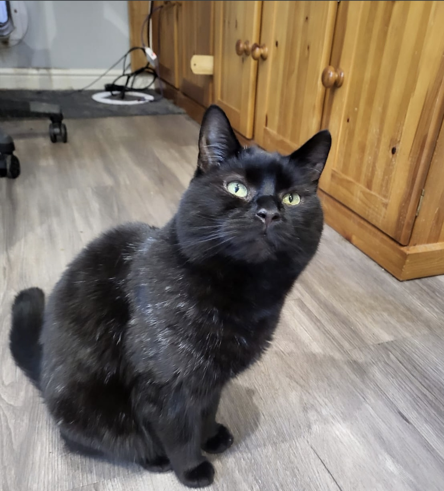
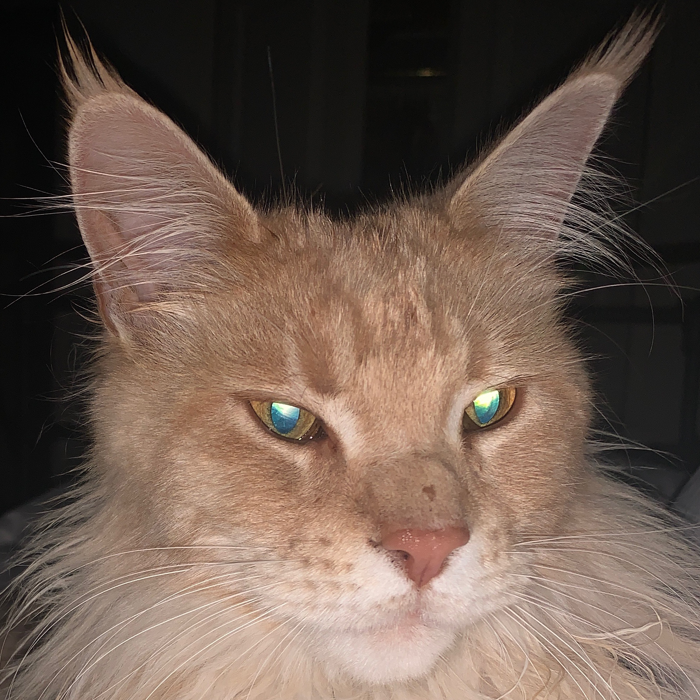
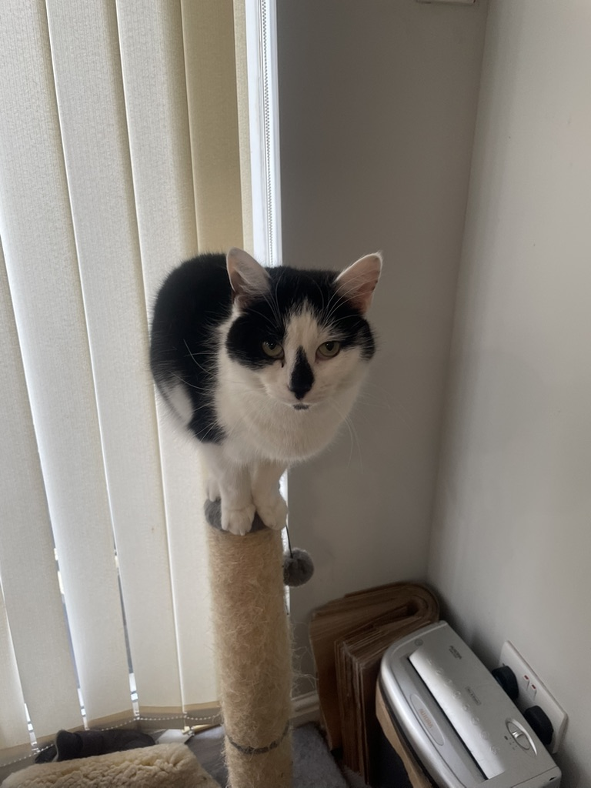
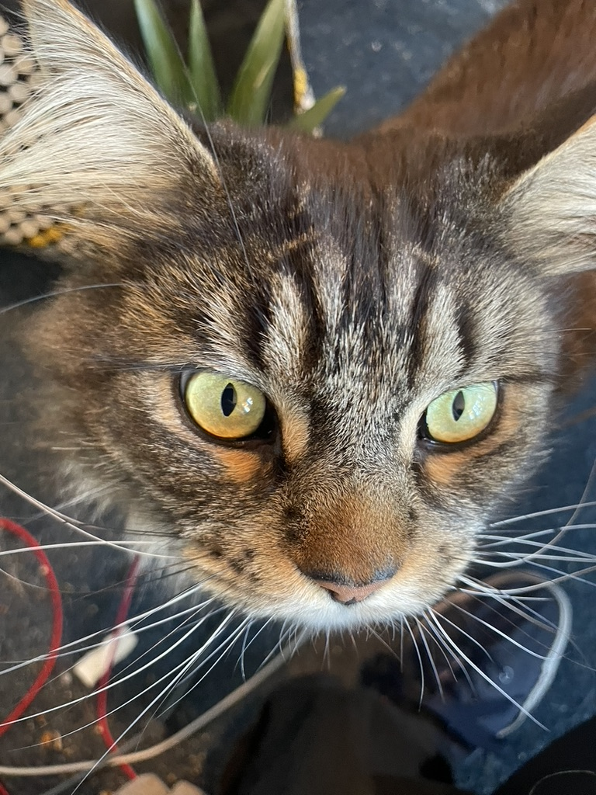
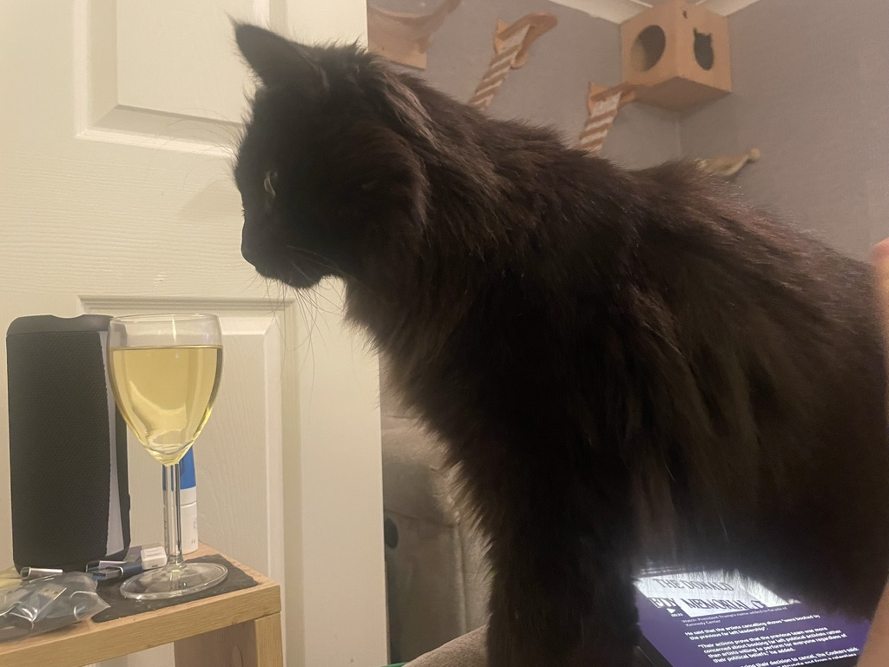
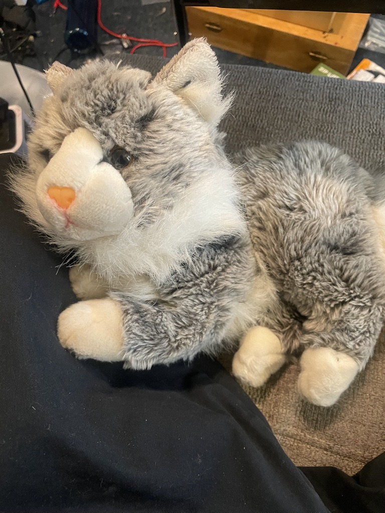
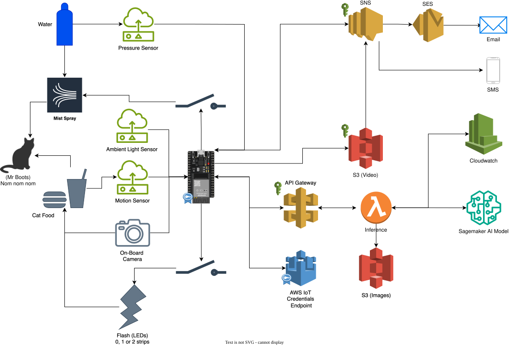

# BootBoots - Autonomous Cat Territory Management System

An IoT system using an ESP32-S3 CAM device with AI-powered cat recognition and a humane deterrent mechanism. The system identifies specific cats and can activate deterrents to manage cat territory boundaries.

## Table of Contents

<!-- toc -->

- [Overview](#overview)
- [Architecture Diagram](#architecture-diagram)
- [Components](#components)
  * [Embedded Firmware](#embedded-firmware)
  * [AWS Infrastructure](#aws-infrastructure)
  * [Documentation](#documentation)
  * [Utilities](#utilities)
- [Supported Hardware](#supported-hardware)
  * [Primary: ESP32-S3 WROOM N16R8 CAM](#primary-esp32-s3-wroom-n16r8-cam)
  * [Legacy: ESP32-CAM AI-Thinker](#legacy-esp32-cam-ai-thinker)
- [Project Structure](#project-structure)
- [Quick Start](#quick-start)
  * [Prerequisites](#prerequisites)
  * [Initial Device Setup](#initial-device-setup)
  * [OTA Updates (Preferred)](#ota-updates-preferred)
- [Cat Safety Logic](#cat-safety-logic)
- [Related Projects](#related-projects)
- [License](#license)

<!-- tocstop -->

## Overview

I have four cats. My neighbour also has a cat — Mr Boots — who has worked out that my cat flap is unlocked and that my cats' food bowl is, from his perspective, a free buffet. For a while the solution was shooing him out whenever I spotted him, but he's persistent, fast, and frankly quite smug about the whole thing. So I built this.

Meet the culprit. Boots is a sleek all-black cat with bright green eyes and an expression of complete innocence that frankly cannot be trusted.

<div align="center"><br/><em>Mr Boots — looking like he's never stolen a meal in his life</em></div>

The system needs to tell Boots apart from my own cats, who are allowed in and must never be on the receiving end of a water mist. Introducing the household:

|  |  |  |
|:---:|:---:|:---:|
| **Mu** — Maine Coon; undisputed matriarch of the household and absolutely aware of it | **Tau** — black and white tuxedo; perches in high places and judges everyone | **Chi** — Maine Coon dark tabby; patriarch of the family and apparently very interested in electronics |
|  |  | |
| **Kappa** — Chi and Tau's son; inherited his dad's fur and his mum's attitude | **Wolf** — not a real cat; a stuffed toy pressed into service as a test subject because he's much easier to pose than the others | |

The AI model is a seven-class classifier trained to recognise each cat individually: Boots, Chi, Tau, Kappa, Mu, Wolf (the stuffed-toy test subject), and NoCat (empty frames). At inference time the classification collapses to a binary spray decision — Boots triggers the deterrent; everyone else is safe. The whole pipeline — camera capture, cloud inference via a SageMaker serverless endpoint running EfficientNetV2B1, and a deterrent sequence of LEDs and a short water mist — runs autonomously. Boots has so far remained unimpressed, but the data is promising.


## Architecture Diagram



## Components

### Embedded Firmware

The [embedded](embedded) directory contains Arduino-based firmware for ESP32 camera devices:

- **[bootloader](embedded/bootloader)** - Factory bootloader that checks for pending OTA updates on every boot. Enables single-partition OTA architecture for maximum firmware space.

- **[catcam](embedded/catcam)** - Main application with camera capture, WiFi, Bluetooth LE, SD card logging, and AI inference integration. Includes 15+ custom libraries:
  - `BluetoothOTA` - Bluetooth-based OTA control
  - `BluetoothService` - Device status monitoring and image transfer via BLE
  - `Camera` - Image capture and PSRAM buffer management
  - `CaptureController` - Capture orchestration
  - `CatCamHttpClient` - HTTPS POST to AWS SageMaker inference API
  - `ImageStorage` - Image file management
  - `InputManager` - Button and input handling
  - `LedController` - RGB LED control
  - `NeoPixel` - WS2812 LED driver
  - `OTAUpdate` - Two-stage OTA update mechanism
  - `PCF8574Manager` - I2C GPIO expander control
  - `SDLogger` - Thread-safe SD card logging with FreeRTOS mutex
  - `SystemManager` - System state management
  - `VideoRecorder` - MJPEG video recording to SD card
  - `WifiConnect` - WiFi connection management

The bootloader-based OTA architecture maximises available flash space by using a single large application partition (7MB on ESP32-S3) instead of the traditional dual-partition approach.

### AI / ML Training

The [local-training](local-training) directory contains the full offline training and deployment pipeline, designed to run on an M-series Mac with Metal GPU acceleration:

- **`download_data_multiclass.py`** — Pulls labelled training images from S3/DynamoDB, organises them into per-cat class directories, and applies an 80/20 training/validation split
- **`train_multiclass.py`** — Trains an EfficientNetV2B1-based seven-class classifier (90.97% validation accuracy; 240×240 input, pipeline augmentation, LR range test support)
- **`predict.py`** — Runs the trained model against individual images or directories for offline evaluation
- **`serve.py`** — Local inference server (localhost:8765) used by the sandbox app to show prediction badges during manual labelling
- **`export_for_sagemaker.py`** — Exports the `.keras` model to TF Serving SavedModel format and packages it as `model.tar.gz`
- **`deploy_model.sh`** — Full deploy pipeline: export → S3 upload → new SageMaker model + endpoint config → live endpoint update

See [local-training/README.md](local-training/README.md) for the full workflow.

### AWS Infrastructure

The [infra](infra) directory is a single AWS CDK app (TypeScript, pnpm) deployed per environment (`NPM_ENVIRONMENT=sandbox|prod`; settings in `infra/lib/env-config.ts`):

- **BootBootsApiGatewayStack** - the BootBoots API (`/infer`, `/upload-video`, `/events`), the inference Lambda, the images bucket and the `catcam-events` table
- **BootBootsIoTStack** - the catcam's IoT Thing, its certificate (in SSM) and the role it assumes
- **BootBootsAiTrainingStack** - the SageMaker serverless endpoint (TF Serving 2.16, EfficientNetV2B1) and the training pipeline
- **NakomisBootbootsStack** - the web panel's Cognito identity pool and its role
- **BootBootsGithubCiStack** - the role GitHub Actions assumes to deploy and publish

### Web Panel

The [web](web) directory is the BootBoots panel: a Module Federation remote of nakomis-shell (app.sandbox.nakomis.com/bootboots) for labelling, bounding, catches and device control over Web Bluetooth or [Fleet](https://github.com/nakomis/nakomis-fleet). It came from `nakomis/nakomis-bootboots`, history and all; its own docs are in [docs/panel/README.md](docs/panel/README.md).

### Documentation

The [docs](docs) directory contains:

- `architecture/architecture-deterrence.drawio` - Live deterrence system architecture
- `architecture/architecture-training.drawio` - ML training pipeline architecture
- [protocol.md](docs/protocol.md) - the device protocol: commands, response types, MQTT topics, BLE UUIDs
- [panel/](docs/panel/README.md) - the web panel's README

SVG versions are auto-generated via pre-commit hook when `.drawio` files change.

### Utilities

The [scripts](scripts) directory contains:

- `install-hooks.sh` - Git hooks installation script

The [githooks](githooks) directory contains git hooks for auto-generating architecture SVGs and TOC updates.

## Supported Hardware

### Primary: ESP32-S3 WROOM N16R8 CAM

| Feature | Specification |
|---------|---------------|
| Chipset | ESP32-S3 (dual-core 240MHz Xtensa LX7) |
| Flash | 16MB (QSPI) |
| PSRAM | 8MB (Octal SPI) |
| Camera | OV5640 (5MP, autofocus) |
| LED | WS2812 RGB addressable (GPIO 48) |
| Storage | microSD card slot |

### Legacy: ESP32-CAM AI-Thinker

| Feature | Specification |
|---------|---------------|
| Flash | 4MB |
| PSRAM | 4MB |
| Camera | OV2640 (2MP) |

## Project Structure

```
bootboots/
├── .github/workflows/ci.yml   # CI: build, test, synth; deploy to sandbox on merge
│
├── docs/
│   ├── architecture/          # System architecture diagrams (.drawio + .svg)
│   ├── panel/                 # Web panel docs
│   └── protocol.md            # Device protocol reference
│
├── embedded/
│   ├── bootloader/            # Factory bootloader (OTA staging)
│   ├── catcam/                # Main camera application
│   │   ├── include/           # Header files
│   │   ├── lib/               # Custom libraries (15+)
│   │   ├── scripts/           # Build and deployment scripts
│   │   └── src/               # Main application source
│   ├── CLAUDE.md              # Detailed technical context
│   └── README.md              # Embedded firmware documentation
│
├── githooks/                  # Git hooks for automation
│
├── infra/                     # Single AWS CDK app (TypeScript, pnpm)
│   ├── bin/infra.ts           # Entry point: NPM_ENVIRONMENT=sandbox|prod
│   ├── lib/                   # CDK stacks and env-config.ts
│   └── lambda/                # Lambda function code
│
├── web/                       # Web panel (nakomis-shell remote, React/Vite)
│
├── local-training/            # Offline ML training pipeline (M-series Mac)
│   ├── download_data_multiclass.py   # Pull labelled images from S3/DynamoDB
│   ├── train_multiclass.py           # Train EfficientNetV2B1 classifier
│   ├── predict.py                    # Offline inference on images
│   ├── serve.py                      # Local inference server (port 8765)
│   ├── export_for_sagemaker.py       # Export to TF Serving format
│   ├── deploy_model.sh               # Full deploy → SageMaker
│   └── README.md                     # Full training workflow
│
├── scripts/                   # Project-wide utility scripts
│
└── README.md                  # This file
```

## Quick Start

### Prerequisites

- Python 3.11 (managed via `asdf`; required for TensorFlow)
- PlatformIO CLI
- Node.js 22+ and pnpm 11 (for infra and the web panel)
- AWS CLI configured with `nakom.is-sandbox` profile
- draw.io desktop app (for architecture diagram generation)
- githooks installed using `./scripts/install-hooks.sh`

### Initial Device Setup

1. **Build and flash** (USB - for factory-new devices):
   ```bash
   cd embedded/catcam
   ./scripts/factory_setup.sh /dev/cu.usbserial-XXXX
   ```

2. **Provision** the device (Thing name, Wi-Fi, IoT certificate and endpoints go into its `prov`
   partition, never into the firmware image):
   ```bash
   ./scripts/provision.sh BootBootsThing /dev/cu.usbmodemXXXX sandbox
   ```

See [embedded/README.md](embedded/README.md) and
[embedded/catcam/docs/provisioning.md](embedded/catcam/docs/provisioning.md) for details.

### OTA Updates (Preferred)

Once a device is set up, publish a checked image and push it through Fleet:

```bash
cd embedded/catcam
FIRMWARE_VERSION=1.0.333 pio run -e esp32s3cam
./scripts/publish-firmware.sh sandbox .pio/build/esp32s3cam/firmware.bin 1.0.333
```

The firmware version is set at build time (`FIRMWARE_VERSION`), and a published version is never
replaced.

## Cat Safety Logic

The deterrence system includes multiple safety layers to prevent false activations:

- **Multiclass classification** — The model identifies each cat individually (Boots, Chi, Tau, Kappa, Mu, Wolf, NoCat) rather than a binary Boots/NotBoots decision, giving greater flexibility in per-cat logic
- **Ultra-safe thresholds** — 90%+ confidence required before triggering the spray
- **Protected cats** — Household cats (Chi, Tau, Kappa, Mu) are hardcoded to never trigger deterrents, regardless of confidence
- **False positive prevention** — Requires 2+ consecutive positive detections
- **Confidence validation** — All non-target classes must show low confidence before acting

## Related Projects

- **[sandboxsite](https://github.com/nakomis/sandboxsite)** - React web interface for OTA updates and device control via Web Bluetooth, plus AWS CDK infrastructure (CloudFront, Cognito, S3)

## License

This project is released under [CC0 1.0 Universal](LICENSE) - public domain dedication.
